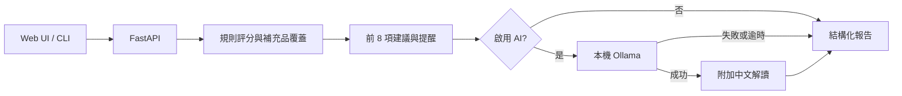

<div align="center">

# NutriMatch 🌿

### 看懂你的營養建議，也看懂建議從哪裡來。

**可解釋營養推薦 × 本地 Ollama 解讀 × 可重用開源模板**

[](https://github.com/momoko-1234/nutrimatch/actions/workflows/ci.yml)
[](LICENSE)


[快速開始](#快速開始) · [操作指南](docs/user-guide.md) · [API 文件](docs/api.md) · [English](docs/README.en.md)

</div>

NutriMatch 將基本資料、生活型態、健康目標與目前使用的補充品，轉成可閱讀的營養優先建議。可以只使用透明的規則分析，也可以啟用本地 Ollama，取得繁體中文解讀。

適合學習全端開發、展示本地 AI 應用，或作為營養教育產品的起點。目前是 **0.1.0 教育原型**，沒有臨床驗證，不能判定營養缺乏或診斷疾病。

## 產品特色

| 特色 | 實際功能 |
|---|---|
| 四步問卷 | 基本資料 → 特殊族群 → 症狀與生活狀態 → 健康目標 |
| 可解釋推薦 | 前 8 項建議、命中原因、食物來源、補充時間及注意事項 |
| 補充品管理 | 以示範目錄選擇目前品項；已覆蓋營養素會降低推薦優先度 |
| 本地 AI | 後端呼叫本機 Ollama 產生中文解讀，不需要 OpenAI API key |
| 可選 AI | 關閉 AI 仍能分析；模型逾時或不可用時保留基本報告 |
| 自動化模板 | 同一 API 支援 Web UI、Streamlit 測試與 CLI 單筆／批次報告 |
| 開發者工具 | TypeScript、FastAPI 自動文件、測試與 GitHub Actions CI |

## 操作示意


以下截圖均使用虛構示範資料，並非真人健康紀錄。


完整步驟見 [操作指南](docs/user-guide.md)。

## 快速開始

需求：**Python 3.11+、Node.js 22 LTS、npm**。Ollama 為選配，模型速度與記憶體需求取決於設備。

```bash
git clone https://github.com/momoko-1234/nutrimatch.git
cd nutrimatch
```

### 1. 後端

```bash
cd backend
python -m venv .venv
```

Windows PowerShell：

```powershell
.\.venv\Scripts\Activate.ps1
Copy-Item .env.example .env
```

macOS / Linux：

```bash
source .venv/bin/activate
cp .env.example .env
```

接著安裝並啟動：

```bash
python -m pip install -r requirements.txt
python -m uvicorn app.main:app --reload --host 127.0.0.1 --port 8000
```

API 文件：[http://localhost:8000/docs](http://localhost:8000/docs)。

### 2. 前端（另一個終端）

```bash
cd frontend
npm ci
npm run dev
```

開啟 [http://localhost:3000](http://localhost:3000)。預設 API 是 `http://localhost:8000`。
自訂網址時，複製 `frontend/.env.example` 為 `.env.local` 後修改並重啟前端。
若使用其他來源，請同步修改後端 `BACKEND_CORS_ORIGINS`。

### 3. 本地 Ollama（選配）

安裝並啟動 [Ollama](https://ollama.com/)，再執行：

```bash
ollama pull qwen2.5:7b
ollama list
```

開啟「使用本地 Ollama 分析」，按 **Generate advice**。首次載入較慢，預設逾時 120 秒。
也可用後端 `OLLAMA_MODEL` 指定已安裝模型，詳見 [Ollama 設定](docs/ollama.md)。
**目前未實作 ChatGPT / OpenAI API。**

## 自動化模板

啟動 API 後，從專案根目錄執行：

```bash
python automation/analyze.py --input examples/profile.json --output reports/demo.json
python automation/analyze.py --input examples/profile.json --output reports/demo.md --format markdown --ollama
```

CLI 不需要額外 Python 套件，支援單筆物件或 JSON 陣列批次輸入。
若 API 使用其他埠，加入 `--api-url http://localhost:8001`。
排程工具可執行相同指令；此版本不會自行建立排程或傳送通知。見 [自動化說明](automation/README.md)。

## 分析如何運作



分數是**推薦優先度**，不是疾病機率。AI 只附加文字，不修改規則分數與排序。
摘要指標也是展示用啟發式數值，不代表健康程度。
歷史 `backend/app/engine/` 未接入 API，舊輸入結構不相容，不能當作已訓練模型使用。
見 [計算方式](docs/scoring.md) 與 [架構](docs/architecture.md)。

## 專案結構

```text
nutrimatch/
├── frontend/          # Next.js 使用者介面
├── backend/
│   ├── app/routes/    # HTTP 路由
│   ├── app/services/  # 規則、目錄及 Ollama
│   ├── app/engine/    # 歷史研究程式（未接入）
│   └── tests/
├── automation/        # CLI / 批次模板
├── examples/          # 虛構範例
├── data/              # 示例產品與營養資料
├── docs/              # 截圖、流程圖、API、部署
└── .github/           # CI、Issue / PR 模板
```

## 開發與測試

```bash
# backend，啟用虛擬環境後
python -m unittest discover -s tests -v

# frontend
npm run lint
npm run typecheck
npm run build
```

CI 不下載模型、不使用真實健康資料。額外 Streamlit 介面需安裝 `backend/requirements-demo.txt`，
再從 backend 執行 `streamlit run streamlit_app.py`。
發布檢查的執行期 npm audit 為 0 項；開發工具仍有已知漏洞，詳見 [安全政策](SECURITY.md)。

## 隱私與限制

- 問卷與報告只存在前端記憶體，沒有帳號或歷史資料庫，重新整理即清除。
- 啟用 AI 會傳到**執行後端主機**的 loopback Ollama；本地模式拒絕外部 URL、代理及 `cloud` 模型名稱。
- 公開部署後，問卷會送往你的後端主機，並非訪客電腦。此模板尚無驗證、限流或多使用者資源隔離。
- 產品目錄是示例資料，未驗證醫療適用性。預設不載入第三方商品圖片。

見 [部署指南](docs/deployment.md)、[安全政策](SECURITY.md) 與 [第三方說明](THIRD_PARTY_NOTICES.md)。

## 參與與路線圖

歡迎 Issue / PR，請先閱讀 [貢獻指南](CONTRIBUTING.md)。

- [x] 四步問卷、規則推薦、本地 Ollama
- [x] CLI 模板與 CI
- [ ] 專業審閱與來源追蹤的營養規則
- [ ] 完整多語言介面
- [ ] 帳號、儲存及公開部署資源控制
- [ ] 可選 OpenAI provider（尚未實作）

## 授權

原創程式與文件採 [MIT License](LICENSE)。DHC 商標屬其權利人，本專案與品牌無隸屬或背書關係。
原型推薦與 AI 文字不能用於診斷或自行調整用藥。
