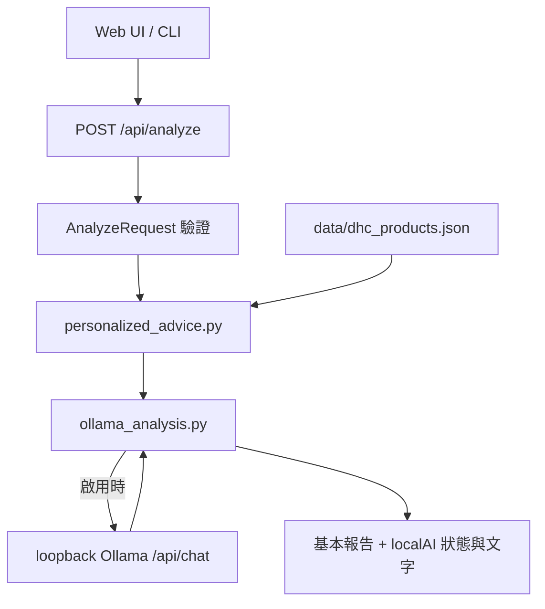

# 系統架構

Next.js 15 / React 19 / TypeScript / Tailwind；FastAPI / Pydantic；可選 Ollama。

- `schemas.py` 是 API 資料契約，驗證範圍與 enum。
- `personalized_advice.py` 計算權重、覆蓋、排序與提醒。
- `ollama_analysis.py` 呼叫本地模型，禁用代理與重新導向，逾時回基本報告。
- `frontend/lib/constants.ts` 直接匯入共用的 `data/dhc_products.json`，避免目錄漂移。
- `streamlit_app.py` 是額外手動測試介面。
- `backend/app/engine/` 是未接入 API 的歷史研究程式，引用舊欄位，未驗證相容性。

無帳號、資料庫、通知、排程器或 OpenAI 呼叫。React state 儲存本次資料。
Ollama 每次取得一份問卷與規則結果，不帶入聊天歷史。
同步模型呼叫占用 worker，多使用者部署需補足資源與併發管理。
