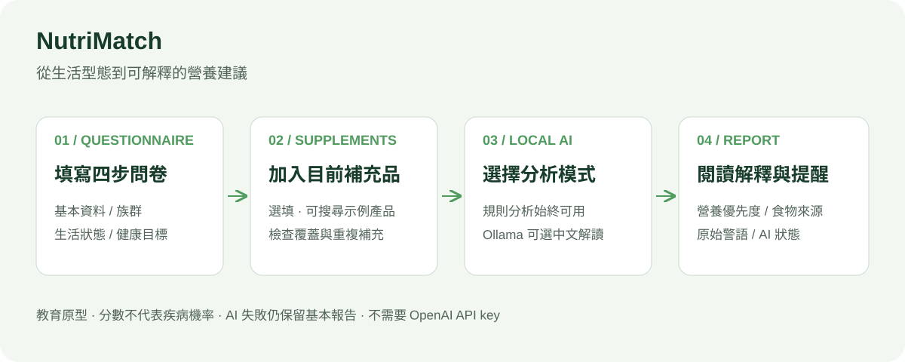
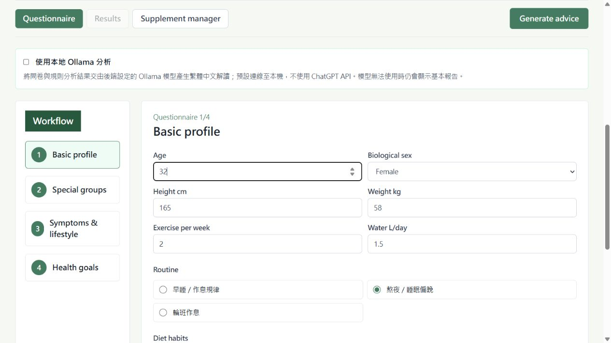
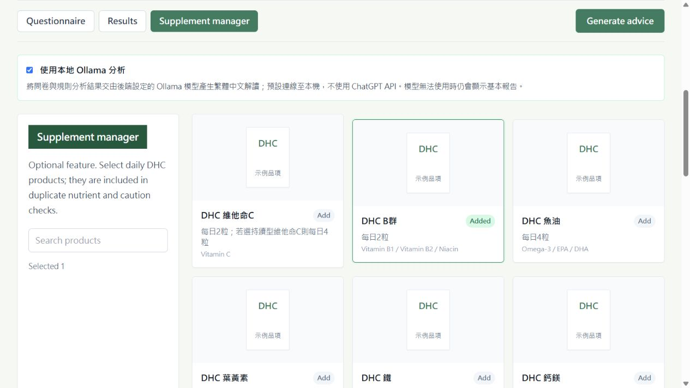
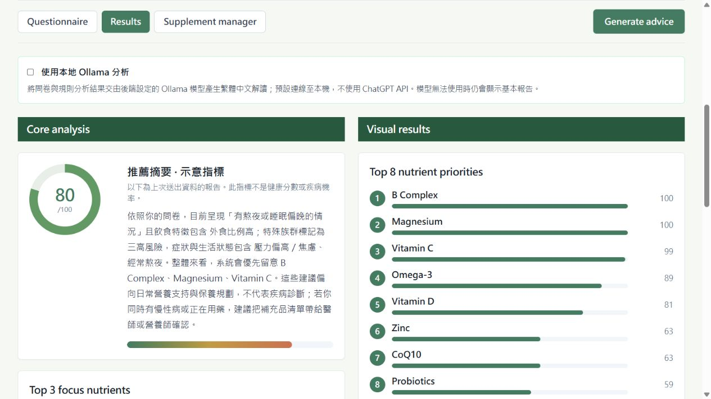
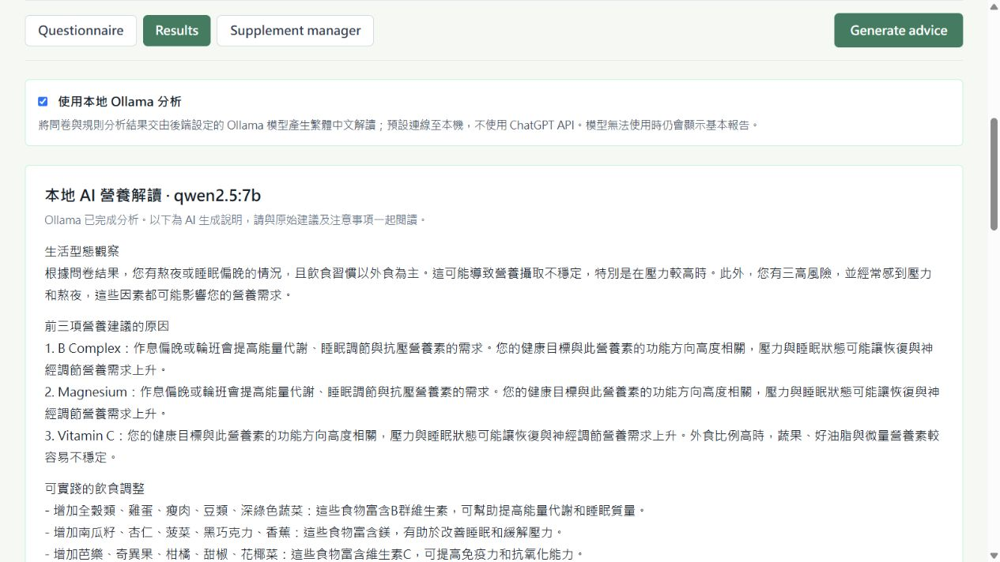

# 操作指南

## 1. 填寫問卷

選 **Questionnaire**，預填值僅為示範。
在 **Basic profile** 輸入年齡、身高、體重、運動與飲水，選擇作息及飲食習慣。

使用 **Next** 或左側步驟依序選擇：

1. **Special groups**：特殊族群，選慢性病族群會展開慢性狀態選項。
2. **Symptoms & lifestyle**：壓力、熬夜等生活狀態。
3. **Health goals**：睡眠、能量等目標。

## 2. 管理補充品（選配）

選 **Supplement manager**，搜尋並點擊示例產品，**Added** 表示已加入，再點一次可取消。
目前沒有實際劑量／頻率或用藥交互作用驗證。

## 3. 分析

關閉 Ollama 開關可直接取得規則報告。開啟時另呼叫本機模型，首次載入可能較慢。
按 **Generate advice**，模型不可用或逾時仍會保留基本結果與狀態說明。

## 4. 看懂結果

前 8 項依推薦優先度排列，條圖與雷達圖來自本次結果。
每項可查看原因、食物來源、時間與警語；原始安全提醒及補充品檢視獨立顯示。
摘要指標不是健康分數或疾病機率。

AI 區顯示模型與生成狀態，文字可能出錯，請對照原始建議。
修改資料後需再按 **Generate advice**；既有報告代表上次送出的資料。
重新整理清除所有輸入，本版本沒有帳號或歷史儲存。

## 疑難排解

| 問題 | 處理 |
|---|---|
| API 連線錯誤 | 確認後端啟動、前端 API URL／埠與 CORS 來源 |
| Ollama 不可用 | `ollama list` 確認模型，檢查 11434，修改 `.env` 後重啟 API |
| AI 太慢 | 關閉 AI 先測基本報告，或改用較小的已安裝模型 |
| 部署後無模型 | 遠端 localhost 是後端主機，需同主機提供 Ollama 或關閉 AI |
